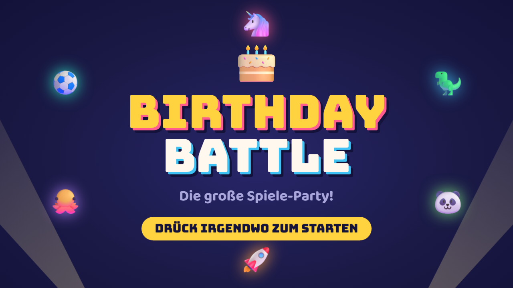
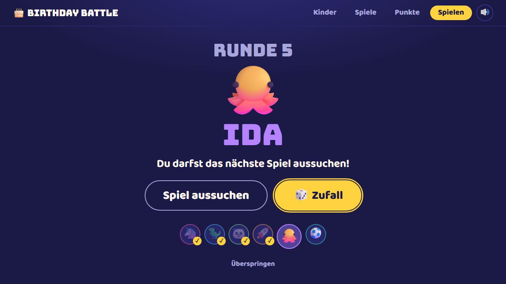
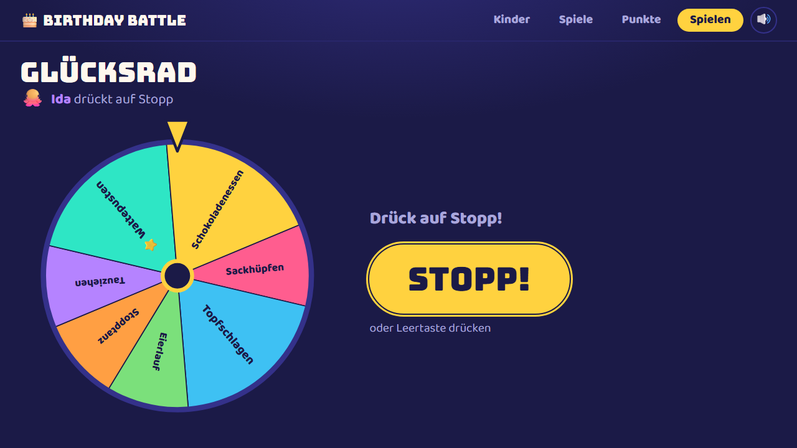
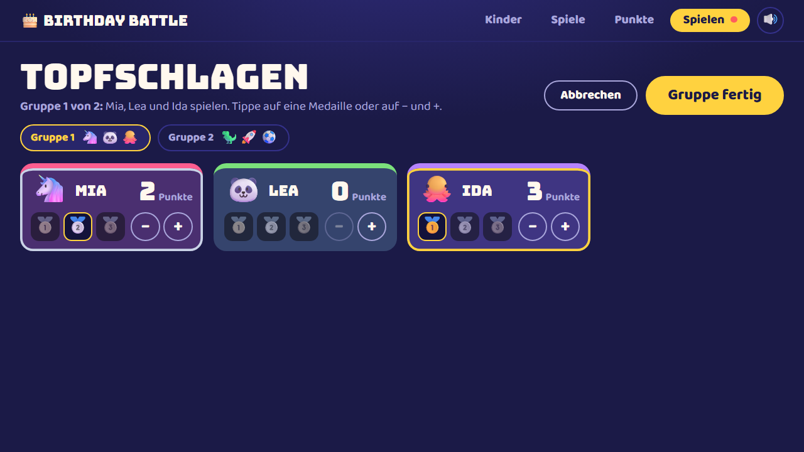
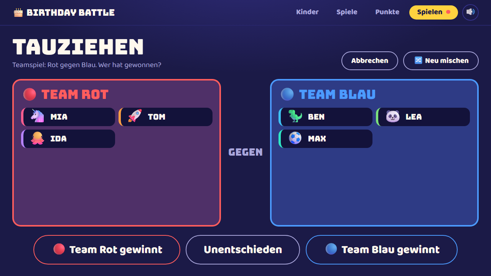
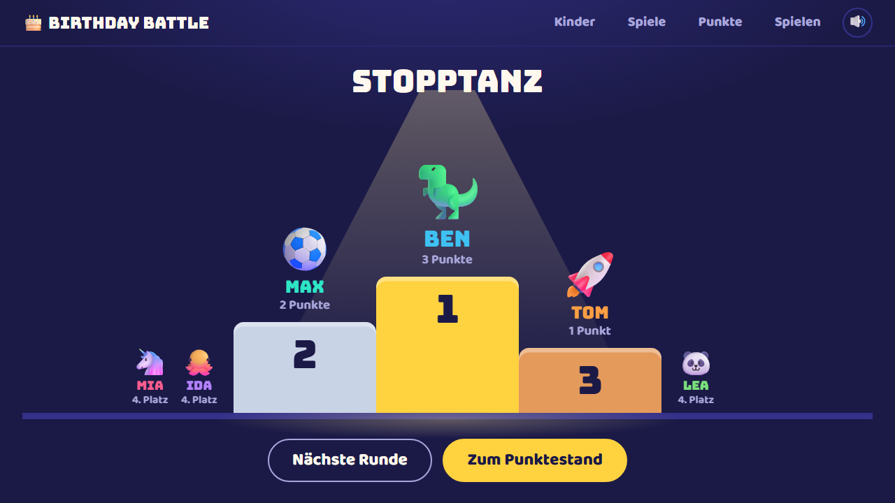
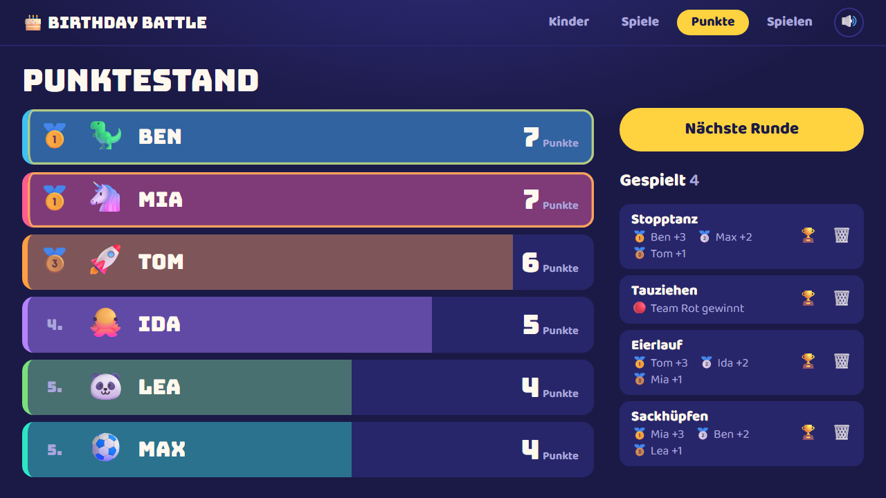
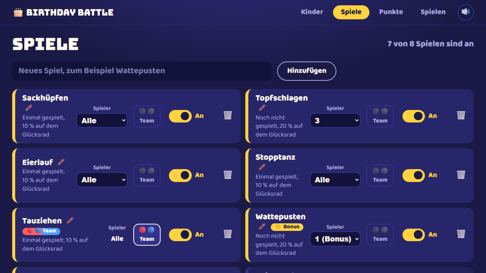

# 🎂 Birthday Battle

A simple scorekeeper for kids' birthday party games. Set up the players, run the games, and watch the scoreboard.



## Getting started

Open `src/index.html` in any modern browser. No install, server or internet connection needed.

Scores are saved in the browser, so refreshing the page won't lose them.

It's designed to be shown on a TV (720p or higher): put the browser in full screen (F11) and the screens scale to fit.

The app's interface is in German.

Sound effects are generated in the browser (no sound files). Use the 🔊 button in the top bar to switch them off or on.

## Features

- **Intro:** opening the page (or clicking the Birthday Battle logo) plays a short intro with music and the kids' avatars, then a start screen; a click or the space bar leads to the Kinder screen
- **Kinder (players):** choose how many kids are playing, enter their names and pick an avatar
- **Spiele (game list):** the games for the party, saved in the browser. Add your own, rename them (✏️), switch off games the kids don't like, or delete them. Set how many kids play at once: with more kids, the game is played in randomly drawn, equal-sized groups, each with its own podium. A 🔴🔵 team game is played by all kids at once, drawn into Team Rot and Team Blau: the winning team gets the 1st-place points, the other team the 2nd-place points. A game for 1 player is a ⭐ bonus game: only the kid whose turn it is plays, for 1 point (2 if they're far behind) or 0 if they don't make it
- **Runden (rounds):** the kids take turns picking the game, in the order they were entered. The round screen shows the round number and whose turn it is; a turn can be skipped. When everyone has had a turn, play another pass or end the party with a final podium of total points
- **Spielen (play):** the kid whose turn it is picks a game from the list ("Spiel aussuchen"), you choose who's playing and award 🥇 🥈 🥉 or custom points
- **🎲 Zufall (Glücksrad):** a spinning wheel with every game that's switched on. It turns slowly for 2 seconds, then fast; a kid presses "Stopp!" and the wheel picks the next game. Each time a game is played its slice halves, until every game has had a turn; then everything counts one round less. A new party starts all games from zero. Bonus games are half as likely, but as likely as an unplayed game when the picking kid is 2+ points behind the leader, and 50 % more likely when they're last
- **Podium:** after each game, a "Sieger" announcement and a podium for the top three, with everyone else on the ground
- **Scoreboard:** everyone ranked by total points, plus a history of games played

## Screenshots

<table>
  <tr>
    <td width="50%"><br><b>Runde:</b> whose turn it is to pick the game</td>
    <td width="50%"><br><b>Glücksrad:</b> press Stopp (or the space bar) to pick a game</td>
  </tr>
  <tr>
    <td><br><b>Spielen:</b> a game played in groups, with medals and points</td>
    <td><br><b>Teamspiel:</b> Team Rot against Team Blau</td>
  </tr>
  <tr>
    <td><br><b>Podium:</b> after every game</td>
    <td><br><b>Punktestand:</b> total points and the games played so far</td>
  </tr>
  <tr>
    <td><br><b>Spiele:</b> the game list and its settings</td>
    <td></td>
  </tr>
</table>

## Project structure

```
src/
  index.html   page markup
  styles.css   styling
  app.js       app logic and saved data
  sound.js     sound effects (generated with Web Audio)
  fonts/       Bungee and Baloo 2 (SIL Open Font License), bundled for offline use
```
